<div align="center">

# ✈️ SKYFORGE STRIKE II

### A realistic 3D jet combat game you can play free in your browser

[](https://jet-3d-game.netlify.app)


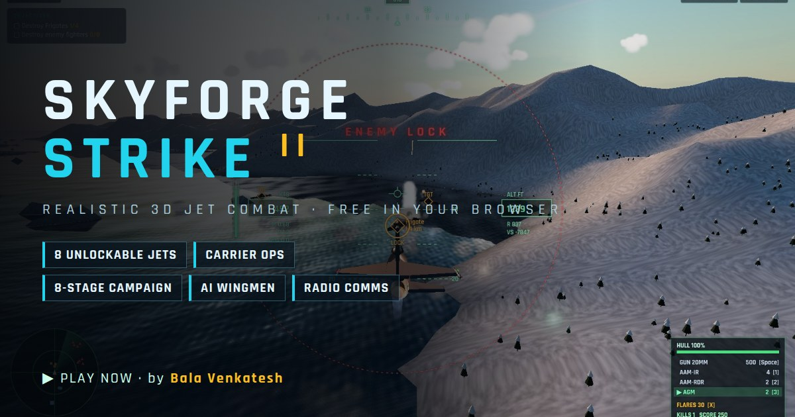

**Launch from a carrier, dogfight alongside AI wingmen, strike SAM sites and warships, then trap a wire back aboard.**
Eight campaign stages across ocean, coast, jungle, mountains, desert and arctic, with 8 fighter jets to unlock.

</div>

---

## 🎬 Gameplay clip

▶️ **[Watch the gameplay video (21s, MP4)](docs/skyforge-strike-gameplay.mp4)**: catapult launch, missile dogfight, mountain canyon run and a desert AGM strike.

## 📸 Screenshots

| Catapult launch | Carrier landing (ICLS + LSO) |
|---|---|
| 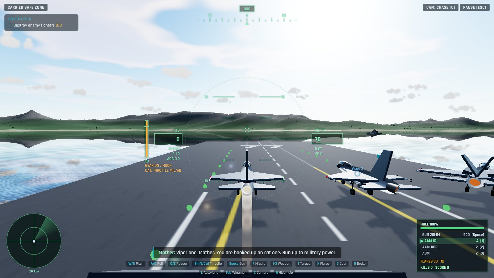 | 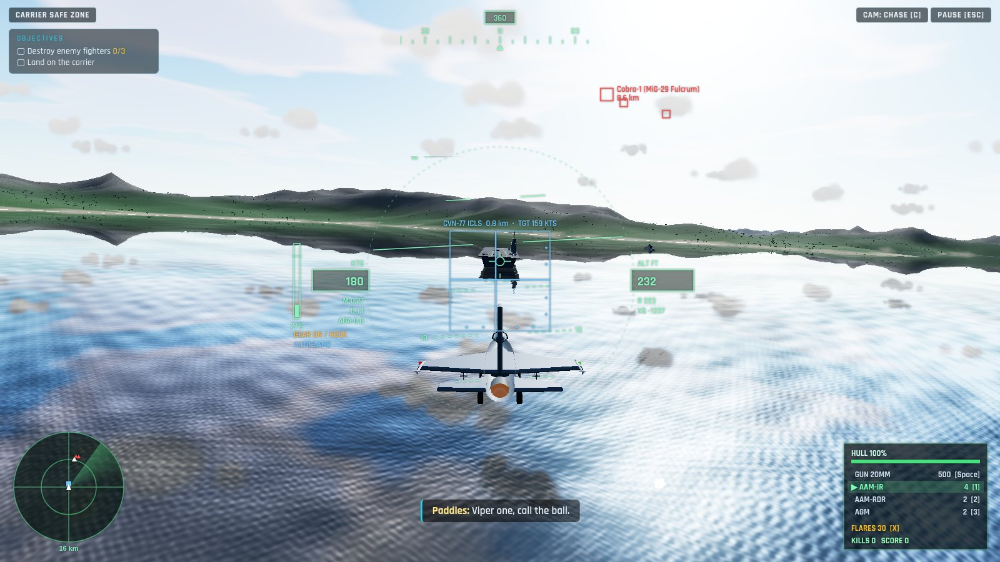 |
| **Arctic sunset naval strike** | **Desert convoy strike** |
| 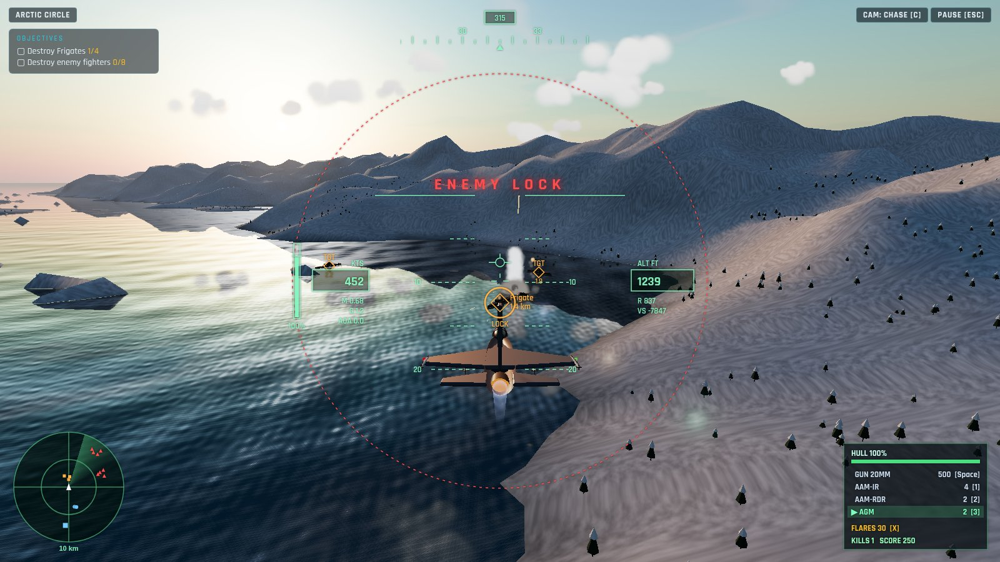 | 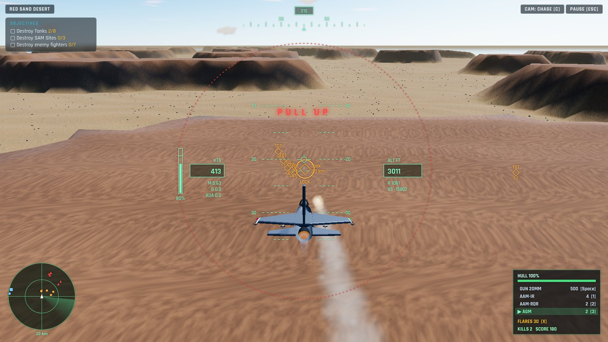 |
| **Thunder Mountains** | **Jungle low-level** |
| 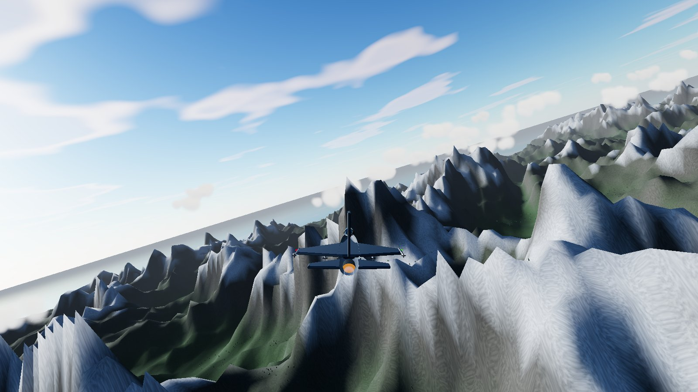 | 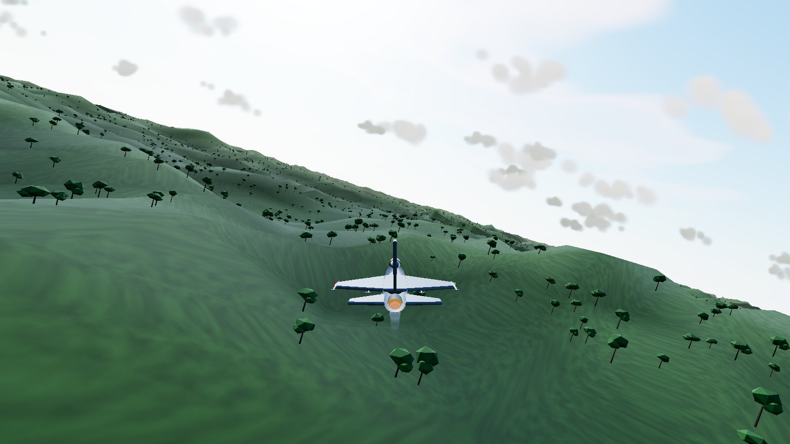 |
| **Coastal front** | **Dogfight** |
| 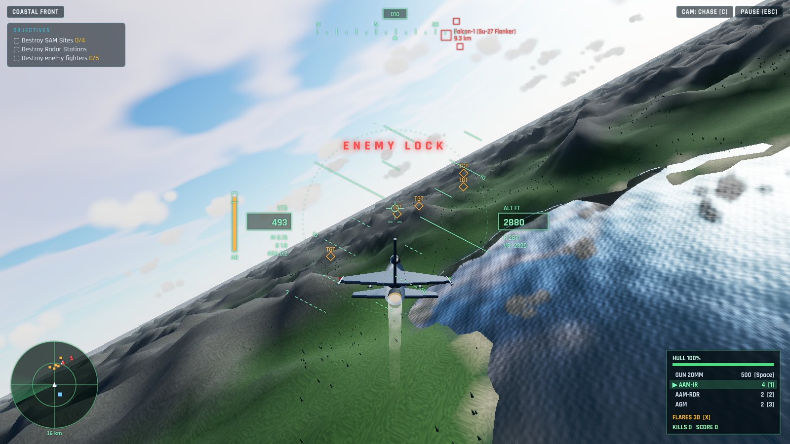 | 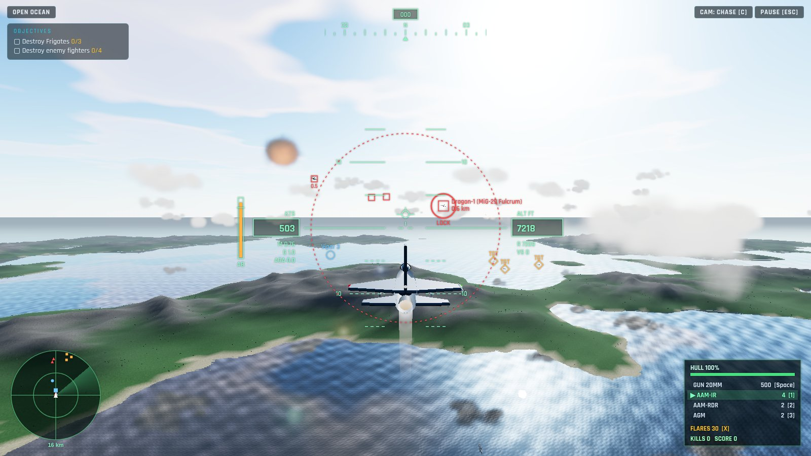 |
| **Hangar: unlocks and liveries** | **Campaign map** |
| 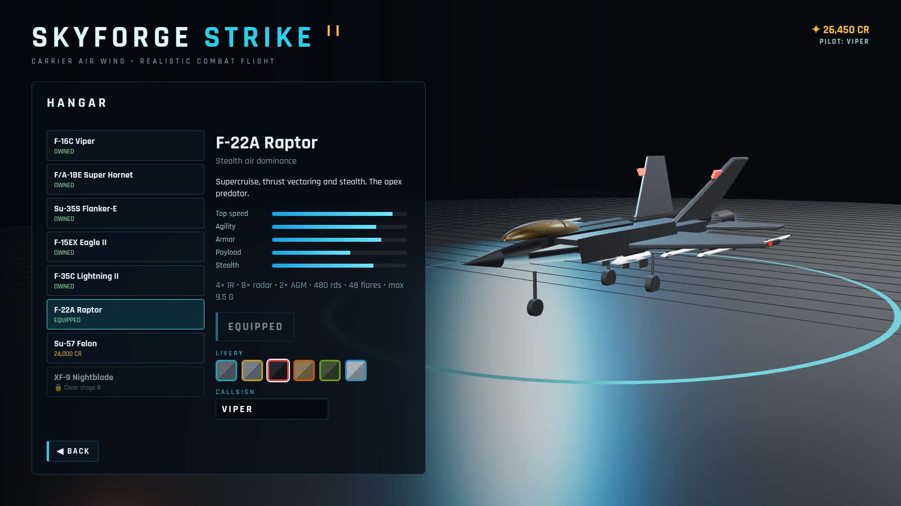 | 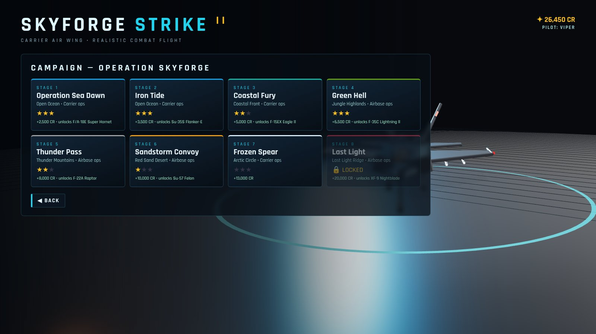 |

## 🚀 Features

**🛫 Carrier and runway operations**
- Catapult launch with throttle run-up, plus runway takeoff with rotation at Vr
- Carrier traps on 4 arresting wires with wire grading, bolters and go-arounds
- ILS/ICLS needles, PAPI lights, LSO calls ("call the ball", "power!"), and **auto-land** on `L`

**🎖️ Campaign and progression**
- 8 stages: *Sea Dawn → Iron Tide → Coastal Fury → Green Hell → Thunder Pass → Sandstorm Convoy → Frozen Spear → Last Light*
- Stars, credits and stage-gated unlocks, saved locally
- 8 jets: **F-16C, F/A-18E, Su-35S, F-15EX, F-35C, F-22A, Su-57, XF-9 Nightblade**
- 6 liveries and a custom callsign
- Skirmish mode with your choice of theater, enemy count, enemy tier, wingmen and ground targets

**⚔️ Combat**
- 20mm cannon with a lead-computing pipper
- IR missiles (seeker growl), radar missiles and air-to-ground missiles
- Flares, with a decoy chance rolled per salvo
- Enemy fighters in 5 tiers, up to the "Black Dragon" aces
- Ground and naval targets: SAM sites, AAA flak, radar stations, frigates, moving convoys, fuel depots and a command HQ
- 1–3 AI wingmen who take off with you and take orders: engage, cover, or attack my target

**🔊 Audio**
- All sound is generated in code: turbine, afterburner, wind, gun, explosions, lock tones and the RWR warning
- Radio chatter from AWACS, tower, LSO and wingmen, spoken with subtitles
- Cockpit voice warnings ("Pull up", "Missile")
- Music that gets more intense in combat

**🌅 Visuals**
- Physical sky with clouds, reflective ocean, procedural terrain and vegetation
- Shadows, lens flare, missile smoke trails, explosions and falling wrecks
- Wingtip vapor, transonic vapor cone, G-LOC blackout and cloud white-out
- 5 cameras: chase, cockpit, far, target lock and cinematic

## 🎮 Controls

| Key | Action | Gamepad |
|---|---|---|
| `W` / `S` (`↑` / `↓`) | Pitch (S = pull up) | Left stick |
| `A` / `D` (`←` / `→`) | Roll | Left stick |
| `Q` / `E` | Rudder | Right stick |
| `Shift` / `Ctrl` | Throttle (above 100% = afterburner) | RT / LT |
| `Space` | Cannon | A |
| `F` | Fire missile | B |
| `1` `2` `3` `4` / `R` | IR / Radar / AGM / Gun, or cycle | D-pad |
| `T` | Cycle target | Y |
| `X` | Flares | X |
| `G` | Gear + tail hook | D-pad ↑ |
| `B` | Speed brake / wheel brakes | D-pad ↓ |
| `L` | Auto-land | L3 |
| `Tab` | Wingman orders | — |
| `C` / `V` | Change camera / look back | Back / R3 |
| `Esc` / `P` | Pause | Start |

**How to play**
1. **Carrier launch:** hold `Shift` to MIL power. The catapult fires automatically.
2. **Runway takeoff:** go to full throttle, then pull `S` at about 140 kts.
3. **Fight:** put the target inside the seeker circle, wait for the solid **LOCK** tone, then press `F`. When the missile warning beeps fast, press `X` for flares.
4. **Land:** lower the gear with `G`, slow to the ILS target speed and follow the needles. Or press `L` for auto-land.

## 🛠️ Run locally

```bash
git clone https://github.com/balavenkatesh3322/jet-3d-game.git
cd jet-3d-game
npm install
npm run dev      # http://localhost:5173
npm run build    # production build -> dist/
```

Use a desktop browser with hardware WebGL (Chrome or Edge recommended). If the frame rate is low, set Graphics Quality to Low or Medium in Settings.

## ☁️ Deploy to Netlify

`netlify.toml` is already set up, with build `npm run build`, publish `dist`, Node 22, asset caching and SPA fallback.

1. In Netlify, choose **Add new site → Import from Git** and pick this repo. It deploys with no further configuration.
2. Under **Site settings → Change site name**, set the name to `jet-3d-game`, or update the URL `https://jet-3d-game.netlify.app` in `index.html`, `public/robots.txt` and `public/sitemap.xml` to match your site.

CLI alternative: `npx netlify-cli deploy --build --prod`

SEO is already in place: title and description, canonical URL, Open Graph and Twitter/X large preview card (`public/og-image.jpeg`, 1200×630), VideoGame JSON-LD, favicon, web manifest, `robots.txt` and `sitemap.xml`.

## 🧱 Tech and architecture

three.js (WebGL), Vite, the WebAudio API and the Web Speech API. There are no binary assets: models, textures, sound and music are all generated in code.

```
src/core      game loop, cameras, input, save
src/world     sky, ocean, terrain, clouds, carrier & airbase
src/aircraft  procedural jet models + flight model
src/combat    missiles, guns, flares, particles
src/ai        AI pilots + ground units
src/game      missions, objectives, auto-land, radio script
src/audio     SFX engine, generative music, radio
src/ui        HUD + menus
```

See [PLAN.md](PLAN.md) for the full development plan.

## 👨‍💻 Creator

**Bala Venkatesh**: 🌐 [balavenkatesh.is-a.dev](https://balavenkatesh.is-a.dev/) · GitHub [@balavenkatesh3322](https://github.com/balavenkatesh3322)

⭐ If you enjoyed flying, star the repo!
